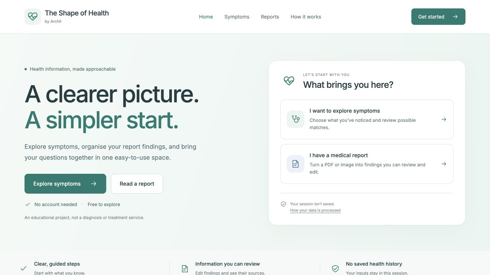
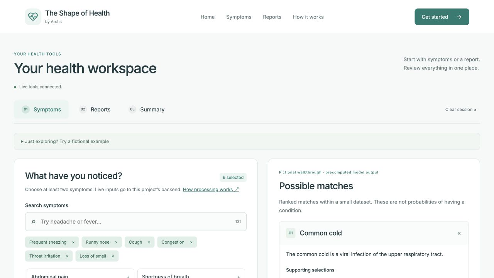
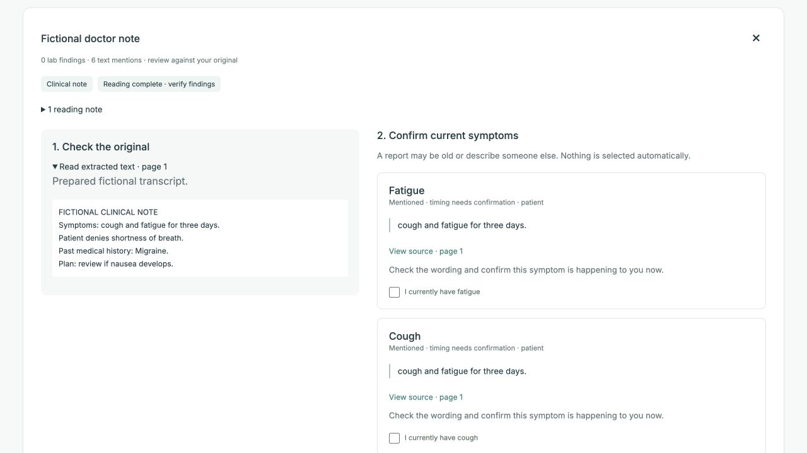
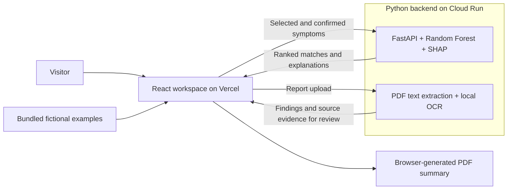

# The Shape of Health

**A clearer picture. A simpler start.**

A full-stack educational health application by **Archit**. Explore symptom patterns, review findings extracted from medical reports, and download a summary with explanations and sources—all through a calm, accessible workspace.

**[Live demo](https://the-shape-of-health.vercel.app/)** · **[Try a fictional case](https://the-shape-of-health.vercel.app/workspace?sample=cold)** · **[Report reader](https://the-shape-of-health.vercel.app/workspace?tab=reports)**

> Educational use only. This project is not clinically validated and does not diagnose conditions, recommend treatment, or estimate personal disease risk.



## What you can do

| Area                   | Experience                                                                                                                                                                     |
| ---------------------- | ------------------------------------------------------------------------------------------------------------------------------------------------------------------------------ |
| **Symptoms**           | Search 131 supported symptoms, answer guided questions, and review the model's three highest-ranked dataset matches with SHAP explanations and educational sources.            |
| **Reports**            | Upload a PDF, JPG, or PNG. Compare extracted text and findings with the original, edit lab values, and explicitly confirm current symptoms before using them in an assessment. |
| **Summary**            | Bring selected symptoms, report findings, model results, and sources together in a paginated PDF generated in the browser.                                                     |
| **Fictional examples** | Explore three symptom walkthroughs, a lab report, and a doctor note without uploading personal information. These examples work without a backend connection.                  |
| **Learn more**         | Read the methodology, condition sources, privacy notice, and project background. An optional adult BMI calculator is separate from the symptom model.                          |

The interface supports keyboard navigation, reduced motion, and responsive layouts. No account is required, and there is no saved health history.

## A look inside

**Symptom exploration.** A fictional cold-like case shows selected inputs beside ranked matches. Results are dataset associations, not a diagnosis.



**Report review.** A prepared fictional doctor note demonstrates source evidence and confirmation controls. An extracted mention is never selected automatically.



These screenshots show the current public interface using fictional examples only.

## How report processing works

1. **Read the document.** Extract positioned text from PDFs; use local Tesseract OCR for scanned pages, image regions, and image uploads.
2. **Organise the findings.** Identify lab rows and clinical mentions, retaining source pages, quotes, extraction methods, and review warnings. The original document and reading transcript remain available.
3. **Review the context.** Separate current mentions from negated, historical, family, uncertain, and hypothetical statements. Conflicting mentions require clarification.
4. **Confirm model inputs.** Only supported symptoms explicitly confirmed as current can enter an assessment. Lab values, diagnoses, reported causes, and duration remain context; they do not become inferred symptoms.
5. **Keep a summary.** Export reviewed information, source evidence, confirmation provenance, and any model results to PDF.

### Supported files and limits

| Item             | Support                                                                                                         |
| ---------------- | --------------------------------------------------------------------------------------------------------------- |
| File formats     | PDF, JPG, PNG                                                                                                   |
| Queue            | Up to three reports per session, processed sequentially                                                         |
| File size        | Up to 10 MB per file                                                                                            |
| PDF length       | Up to ten pages per PDF                                                                                         |
| Image resolution | Up to 20 megapixels per image                                                                                   |
| Document content | English lab reports, clinical notes, discharge summaries, and written radiology reports, on a best-effort basis |

The parser uses deterministic rules and a bounded vocabulary. It can miss unfamiliar wording, complex tables, or low-quality text. Handwriting and non-English documents are not reliably supported, and it does not interpret diagnostic images such as X-rays or CT scans. Missing values stay missing; blank templates and unreadable pages can produce no findings. **Empty extraction does not mean normal results.** Review the original before using any extracted information.

## Architecture



| Layer                       | Tools                                                                |
| --------------------------- | -------------------------------------------------------------------- |
| Interface                   | React, TypeScript, Vite, React Router, custom CSS, self-hosted Inter |
| Document preview and export | Lazy-loaded PDF.js, jsPDF                                            |
| API and validation          | FastAPI, Pydantic, generated OpenAPI TypeScript types                |
| Model and explanations      | scikit-learn Random Forest, NumPy, SHAP                              |
| Report extraction           | pypdf, PDFium, Pillow, Tesseract                                     |
| Verification                | pytest, Vitest, Testing Library, GitHub Actions                      |
| Hosting                     | Vercel frontend, containerised API on Google Cloud Run               |

The frontend calls Cloud Run directly. Reports do not pass through a Vercel function. The container bundles the model and catalog, with no startup downloads or database dependency.

## Run locally

Use **Node.js 24**, **Python 3.12**, and **Docker** for the OCR-enabled backend. The evaluated model is included, so training is not required to start the application.

```sh
git clone https://github.com/Archit-k20/AI-Powered-Health-Prediction-Web-App.git
cd AI-Powered-Health-Prediction-Web-App
```

### 1. Start the backend

From the repository root:

```sh
docker compose up --build
```

This serves the API at `http://localhost:8080` and includes Tesseract with English language data. Check `http://localhost:8080/api/v1/health`; interactive API documentation is at `http://localhost:8080/docs`.

<details>
<summary>Run Python directly instead of Docker</summary>

```sh
python3.12 -m venv .venv
.venv/bin/python -m pip install -r backend/requirements.lock
.venv/bin/python -m uvicorn backend.app:app --port 8080 --no-access-log
```

Install Tesseract with English language data and make the `tesseract` executable available on your `PATH` for scanned reports. Without it, embedded PDF text and symptom assessments still work; OCR is reported as unavailable.

</details>

### 2. Start the frontend

In a second terminal:

```sh
cd frontend
npm ci
VITE_API_URL=http://localhost:8080 npm run dev
```

Open `http://localhost:5173`. With no `VITE_API_URL`, the homepage and fictional examples still work; live tools display an unavailable state.

### Configuration

| Variable          | Where                   | Purpose                                                                                           |
| ----------------- | ----------------------- | ------------------------------------------------------------------------------------------------- |
| `VITE_API_URL`    | Frontend, at build time | Backend base URL, without `/api/v1`                                                               |
| `ALLOWED_ORIGINS` | Backend                 | Comma-separated exact frontend origins; defaults to `http://localhost:5173,http://127.0.0.1:5173` |
| `GEMINI_API_KEY`  | Backend only, optional  | Enables explanations for predefined fictional case IDs                                            |
| `GEMINI_MODEL`    | Backend, optional       | Configured model name; defaults to `gemini-3.5-flash-lite`                                        |

Use the exact origin printed by Vite if it selects a different port. See [`.env.example`](.env.example) for backend variable names; variables must be supplied to the process or hosting environment. Never put a private key in a `VITE_` variable.

## Model and evaluation

The training pipeline selects all 17 explicit symptom columns, normalises names, and deduplicates identical patterns **before** splitting. Disease labels are targets only. The deployed model is a 100-tree Random Forest with seed 42; logistic regression provides a comparison baseline.

| Dataset property            |                 Value |
| --------------------------- | --------------------: |
| Original rows               |                 4,920 |
| Unique symptom patterns     |                   304 |
| Supported symptom features  |                   131 |
| Dataset condition labels    |                    41 |
| Training / holdout patterns |              243 / 61 |
| Training cross-validation   | Four stratified folds |

| Model               | Holdout accuracy | Macro F1 | Top-three recall | Mean CV accuracy |
| ------------------- | ---------------: | -------: | ---------------: | ---------------: |
| Random Forest       |           1.0000 |   1.0000 |           1.0000 |           0.9959 |
| Logistic regression |           1.0000 |   1.0000 |           1.0000 |           1.0000 |

**These perfect holdout scores are not evidence of clinical accuracy.** The dataset is small and highly repetitive, and its clinical provenance, collection process, and population are undocumented. Evaluation uses only 61 internal patterns. The model cannot establish a diagnosis, assess urgency, or generalise reliably to unrepresented conditions. Unselected symptoms are encoded as absent; age, lab values, BMI, and duration are not model features.

The [evaluation report](docs/EVALUATION.md) includes per-class results and limitations. [Model metadata](backend/models/metadata.json) records feature order, class mapping, split hashes, dataset checksum, dependency versions, and the model checksum. Startup checks artifact integrity and schema compatibility before enabling assessments.

### Reproduce the evaluated artifacts

From the repository root, with a Python 3.12 virtual environment:

```sh
.venv/bin/python -m pip install -r training/requirements.txt
.venv/bin/python training/train.py
.venv/bin/python training/export_samples.py
npm --prefix frontend run types
```

`training/train.py` is the supported training entry point. `training/catalog.py` separately generates the attributed educational catalog. The original CSV remains necessary for reproducibility; its presence does not establish clinical validity or an upstream data licence.

## Privacy and optional AI

- Live symptoms and uploaded reports are processed by this application's Python backend on Cloud Run in `us-central1`. **Real visitor health inputs are never sent to Gemini.**
- Health inputs, original files, and extracted transcripts remain in browser memory. Backend uploads are transient, with no persistent report storage or saved health history. Application code does not log raw health content; hosting providers may retain request metadata.
- Only the motion preference is stored locally. There are no accounts or health-history databases.
- Gemini accepts only allowlisted fictional case IDs, with no visitor-written text, query parameters, or uploads. Its supplied catalog citations are validated. Missing credentials, quota errors, and malformed responses return clearly labelled prepared explanations.

Core features work without an AI key. The public demo currently uses prepared explanations because Gemini is not configured. Read the [privacy notice](https://the-shape-of-health.vercel.app/privacy) for the visitor-facing explanation.

## API

| Endpoint                                   | Purpose                                                            |
| ------------------------------------------ | ------------------------------------------------------------------ |
| `GET /api/v1/health`                       | Readiness, model version, and available capabilities               |
| `GET /api/v1/symptoms`                     | Versioned symptom IDs, labels, aliases, and guided questions       |
| `POST /api/v1/assessments`                 | Validated inputs → ranked matches, explanations, and sources       |
| `POST /api/v1/reports/extract`             | One uploaded document → findings, mentions, evidence, and warnings |
| `GET /api/v1/model-info`                   | Evaluation metrics and limitations                                 |
| `POST /api/v1/samples/{sample_id}/explain` | Optional explanation for a predefined fictional case               |

Pydantic models define the API contract. [`shared/openapi.json`](shared/openapi.json) generates [`frontend/src/generated/api.ts`](frontend/src/generated/api.ts). Report-derived inputs require `confirmed_current: true`; the server rejects unconfirmed or unsupported inputs. Assessments require at least two distinct supported symptoms.

## Tests and quality checks

Install `training/requirements.txt` and the frontend dependencies, then run:

```sh
.venv/bin/python -m pytest backend/tests -q
npm --prefix frontend run types
npm --prefix frontend test
npm --prefix frontend run build
```

[GitHub Actions](https://github.com/Archit-k20/AI-Powered-Health-Prediction-Web-App/actions/workflows/verify.yml) runs the backend suite with real Tesseract, retrains and compares artifacts, checks generated API types, and runs frontend interaction tests and the production build. All committed report fixtures are fictional.

See the [testing guide](docs/TESTING.md) for OCR prerequisites, reproducibility checks, coverage, and a browser smoke test. Passing regression tests does not constitute a clinical extraction benchmark.

## Deployment

The frontend is hosted on Vercel and the API on Cloud Run in a separate GCP project. Cloud Run uses one vCPU, 1 GiB memory, one worker, minimum zero and maximum one instance, concurrency four, and a 120-second request timeout. Extraction has its own bounded queue and processing deadlines.

The service scales to zero, so the first live request after inactivity may take longer. Fictional examples remain available during backend startup or failure. The target running cost is ₹0 under provider allowances, but billing alerts are **not a spending cap** and charges remain possible.

Follow the [deployment and operations guide](docs/DEPLOYMENT.md) to configure origins, deploy both services, manage optional secrets, and verify a release. The current deployment uses local prebuilt output; pushing Git commits does not automatically redeploy the public site.

## Repository map

```text
backend/
  app.py                 FastAPI application and service safeguards
  health/                Model service, document parsing, schemas, sample explanations
  models/                Evaluated model and integrity metadata
  tests/                 Backend tests and fictional report fixtures
data/dataset.csv         Source dataset for reproducible training
frontend/
  src/                   React interface, API client, report review, PDF export, tests
  public/                Static assets and font licence
shared/                  Symptom registry, catalog, examples, evaluation, OpenAPI contract
training/                Training, catalog, example, and fixture generation scripts
docs/                    Evaluation, testing, deployment, and current screenshots
.github/workflows/       Automated verification
```

## Credits

Created by [Archit](https://github.com/Archit-k20), developed from a college health-exploration project. Educational condition descriptions link to [MedlinePlus](https://medlineplus.gov/), a resource of the U.S. National Library of Medicine; these sources do not validate the model. The interface uses [Inter](https://rsms.me/inter/), with its licence included in [`frontend/public/inter-license.txt`](frontend/public/inter-license.txt).
